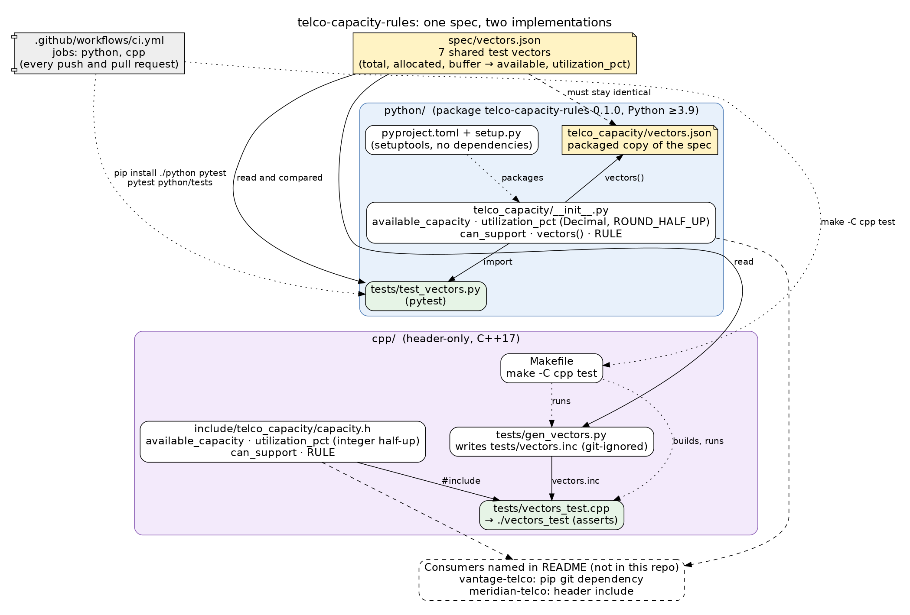

# Architecture

`telco-capacity-rules` is a small rules library: one set of capacity formulas, implemented twice (Python and C++), both checked against the same JSON test vectors. It has no runtime services, storage or network calls.

The diagram source is [`diagrams/architecture.dot`](diagrams/architecture.dot) (Graphviz). After editing it, run [`diagrams/render.sh`](diagrams/render.sh) to refresh `architecture.png` and `architecture.svg`.

## Layout

| Path | What it is |
| --- | --- |
| `spec/vectors.json` | The shared test vectors: 7 cases of `total`, `allocated`, `buffer` with the expected `available` and `utilization_pct`. Both test suites read this file. |
| `python/telco_capacity/__init__.py` | Python implementation: `available_capacity`, `utilization_pct`, `can_support`, `vectors()` and a `RULE` string. |
| `python/telco_capacity/vectors.json` | Copy of `spec/vectors.json` shipped as package data, returned by `vectors()`. |
| `python/pyproject.toml`, `python/setup.py` | setuptools packaging for the distribution `telco-capacity-rules` 0.1.0 (Python 3.9+, no dependencies). |
| `python/tests/test_vectors.py` | pytest suite (one test). |
| `cpp/include/telco_capacity/capacity.h` | Header-only C++17 implementation in namespace `telco_capacity`: `available_capacity`, `utilization_pct`, `can_support` and a `RULE` string. |
| `cpp/tests/gen_vectors.py` | Generates `cpp/tests/vectors.inc` (git-ignored) from `spec/vectors.json`. |
| `cpp/tests/vectors_test.cpp` | Assert-based test program built as `cpp/vectors_test` (git-ignored). |
| `cpp/Makefile` | `make -C cpp test` regenerates `vectors.inc` when the spec changes, builds `vectors_test` and runs it; `make -C cpp clean` removes both. |
| `.github/workflows/ci.yml` | CI on every push and pull request: a `python` job and a `cpp` job running the two suites. |

## The rules

All values are integer Mbps. `buffer` (the maintenance buffer) defaults to 0 in both implementations.

| Function | Rule |
| --- | --- |
| `available_capacity(total, allocated, buffer)` | `max(total - allocated - buffer, 0)` |
| `utilization_pct(total, allocated, buffer)` | `(allocated + buffer) * 100 / total`, rounded half-up to 2 decimals and not capped at 100; `0.0` when `total <= 0`. Python uses `Decimal` with `ROUND_HALF_UP`; C++ scales by 10000 and rounds with integer division. |
| `can_support(available, requested)` | `available >= requested` |

## How the two implementations stay in step

There is no code generation between the languages; each implementation is written by hand. They are kept consistent by testing both against `spec/vectors.json`:

- **Python:** `test_vectors.py` loads `spec/vectors.json`, checks that the packaged copy returned by `vectors()` is identical, then checks `available_capacity` and `utilization_pct` for every vector. It runs against the installed package, so install `./python` first.
- **C++:** `gen_vectors.py` turns `spec/vectors.json` into a C array in `vectors.inc`; `vectors_test.cpp` checks `available_capacity` and `utilization_pct` for every vector (to within 0.000001) and two `can_support` cases. It prints nothing when it passes.

When you change a rule, update `spec/vectors.json`, copy it to `python/telco_capacity/vectors.json`, and update both implementations.

## Consumers

The README names two consumers outside this repository: `vantage-telco` (through a pip git dependency on the Python package) and `meridian-telco` (through an include of the C++ header). Neither is referenced from code in this repository.
